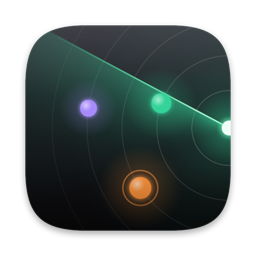
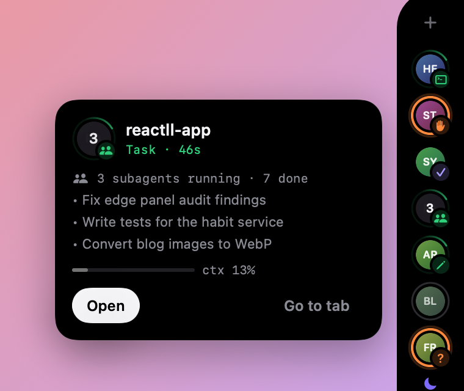
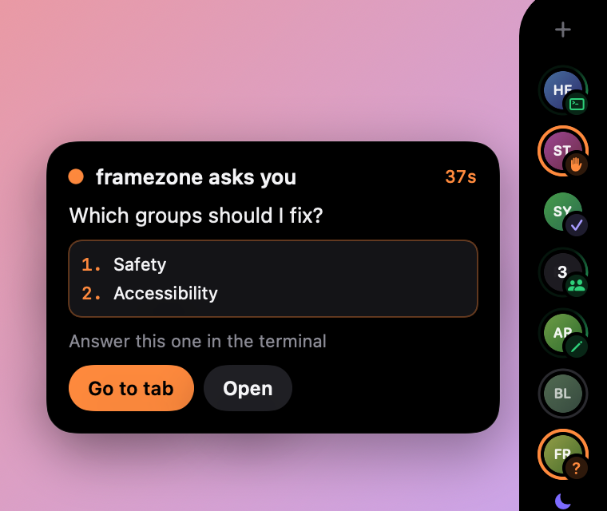
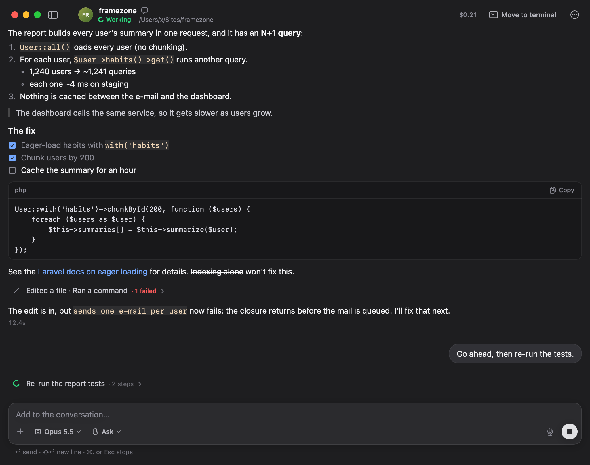
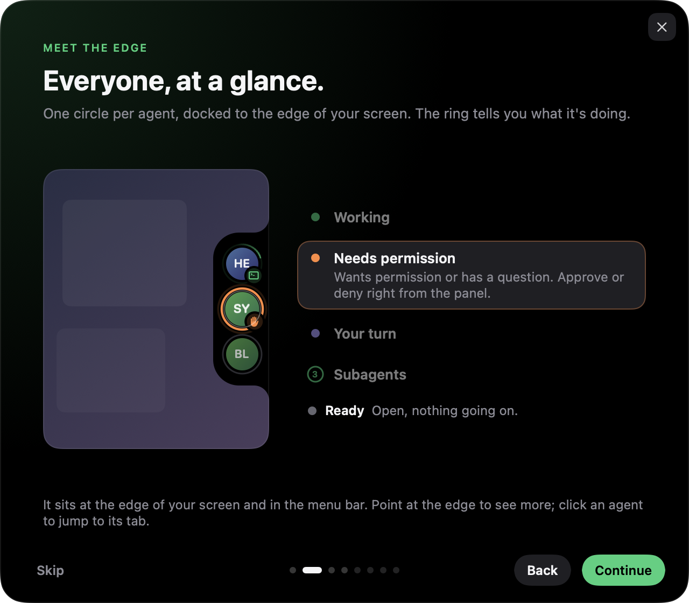
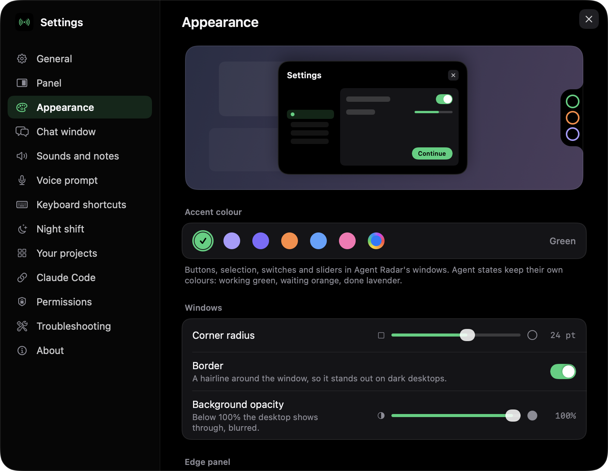

  

<h1 align="center">Agent Radar</h1>

<h3 align="center">Five agents, twelve tabs, three screens. Know which one is waiting for you.</h3>

  <a href="https://github.com/yergunes/agent-radar-releases/releases/latest"><b>⬇&nbsp;Download for macOS</b></a>
  &nbsp;·&nbsp; macOS 14 or later &nbsp;·&nbsp; Apple Silicon &amp; Intel

---

Agent Radar is a small macOS app for people who run several **Claude Code** (and Codex) agents in their terminals at once. It docks a slim panel to the edge of your screen with one circle per agent, so you see at a glance who is working, who needs your permission and who has finished — and you can answer without hunting for the right tab.

  
  &nbsp;
  

## What it does

**👀 Every agent at the edge of your screen.** One circle per session, with its project's own icon. A calm comet while it works, an orange pulse when it needs permission, a ✓ when it's your turn, and the number of running subagents right inside the circle.

**✋ Answer without hunting.** Approve or deny a permission request straight from the panel (or with <kbd>⌥</kbd><kbd>⇧</kbd><kbd>↩</kbd>). Questions and plans show their options, and one click takes you to the exact iTerm or Terminal tab and pane.

**⚡️ Jump anywhere.** <kbd>⌥</kbd><kbd>⇧</kbd><kbd>A</kbd> opens a switcher in the middle of the screen, sorted by who needs you. <kbd>⌥</kbd><kbd>⇧</kbd><kbd>Space</kbd> jumps to the next agent that's waiting. Every shortcut can be changed.

**💬 A native chat window.** Start a new session or open any running one in a Mac-native chat: tables and code render properly, tool calls fold into calm one-line groups, switch model and permission mode on the fly, paste screenshots, and move the conversation back to a terminal whenever you like.

  

**🎙 Talk to your agents.** Hold <kbd>⌥</kbd><kbd>Space</kbd> and speak a prompt; it goes to the agent you're looking at.

**🌙 Night shift.** Queue prompts per project; they start one at a time while you sleep, within your usage limits, with a morning report.

**📁 Your projects, with their icons.** Projects come from your Claude Code history; Agent Radar finds each one's app icon, touch icon or favicon by itself, and you can pick another from a gallery.

**🎨 Make it yours.** Left or right edge, icon size, opacity, accent colour, window corners — and it slides out of the way when nothing is happening, or when a full-screen video is playing.

  
  &nbsp;
  

## Install

1. Download the latest **AgentRadar-x.y.z.dmg** from [Releases](https://github.com/yergunes/agent-radar-releases/releases/latest).
2. Open it and drag **Agent Radar** into **Applications**.
3. Launch it. The welcome guide connects Claude Code (a small local plugin and a status-line wrapper; both can be removed from Settings at any time).
4. In Claude Code sessions that were already open, run `/reload-plugins` once.

The app is signed with a Developer ID and notarized by Apple. Updates arrive automatically.

## Privacy

Everything stays on your Mac. Agent Radar reads the events your agents report through the plugin and the transcripts Claude Code already writes; there is no account, no server and no analytics. Event logs of ended sessions are deleted after a few days (you choose how many).

---

Designed and built by Sedat Yusuf Ergüneş · © 2026 Reaktor Teknoloji · Made in Istanbul

